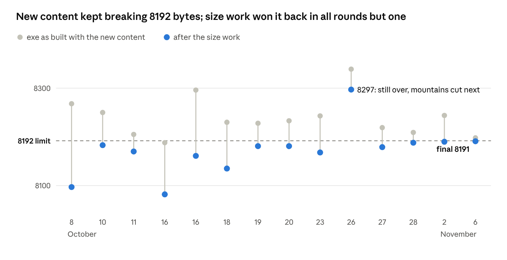

# WHISP — the making of a REBELS 8K intro

Windows 8K intro made with AI, released at Comparade 2026.

Code, visuals and sound: **skarab** · opening notes and mood of the music: **teo** · REBELS logo: **critikill**

Made with **Claude Opus 5.5** (Anthropic) on a **Claude Pro** subscription, for every session: visuals, sound and the byte hunting.

**Download:** [2026_11_07_whisp.7z](https://downloads.kstorm.org/2026_11_07_whisp.7z) (the party version) · **Demozoo:** [WHISP](https://demozoo.org/productions/400489/)

## What WHISP is

WHISP is an 8K intro by REBELS: one Windows exe of **8191 bytes** that plays 114 seconds of picture and music, all generated on the GPU when it starts. Nothing is stored but code: no images, no meshes, no samples.

The story is a storm on a moonlit plain. After a 20-second prologue, a calm cloud deck starts to turn and lowers into a wall cloud. A funnel descends, touches down at 35 s, and tears out the trees and shrubs one after another. From 40 s the scene slides into an apocalypse: thicker fog, harder rain, heavier thunder. At 70 s the storm steps back for a heartbeat break in slow motion. At 80 s it comes back in full, and the intro ends in a fade to black with the storm still rumbling.

It grew out of a 4K framework: the brick system of skarab's Vulkan RTX volume demos, ported to OpenGL compute so it fits a 32-bit Crinkler build.

## Timeline

Five weeks, from a cloud renderer to a finished storm. The exe sizes of each round are in the chart under The size fight.

| When (2026) | What happened |
| --- | --- |
| Early October | The 4K framework: procedural clouds through the brick system of the Vulkan RTX demos, ported to OpenGL compute |
| 4 October | With the soundtrack the 4K build is 5197 bytes: the target becomes 8K, and the realistic thunder and the heartbeat break come back |
| 8 October | First size review: the 8K exe goes from 8268 to 8097 bytes |
| 10–13 October | Fullscreen letterbox, sheet lightning, uprooted trees, first mountains; the sound gets sub hits, a muffled break, a held breath and a tinnitus ring |
| 16–18 October | Debris and ground mist, a ring of mountains, then shrubs instead of debris, grass, and a sound for every uprooting |
| 19–20 October | Birds fleeing the storm; the lens flare |
| 23–25 October | The heart drives the flare and kicks the camera; lens rain tried and dropped; a GPU timer to chase the frame rate |
| 26 October | 3D rain, reflective puddles, lens drops, 48 kHz sound: 8339 bytes, the furthest over the limit |
| 27–28 October | Mountains cut, lighter soundtrack, smaller volumes: back under; the rain stops seeming to fall upward |
| 2 November | The marched floor shadow is back; slow motion in the heartbeat break |
| 6 November | Final version: 24 birds, six layers of rain, smaller texts, new cameras, **8191 bytes** |

## Visuals

The whole picture comes from one GLSL source compiled seven times, one pass each. The world is a unit box, so a position in it is directly a texture coordinate.

| Pass | Runs | What it makes |
| --- | --- | --- |
| 0 Noise | once | a tileable 3D noise for the cloud shapes and erosion |
| 1 Density | every frame | the storm and the trees as a 320³ volume (clouds + solids) |
| 2 Bricks | every frame | which 8³ bricks of the volume hold anything, so empty space is skipped |
| 3 Light | every frame | moonlight depth and sky visibility for every voxel, 64³ |
| 4 Render | every frame | camera rays through the bricks: clouds, trees, floor, grass, rain, fog, lightning |
| 5 Audio | once | the whole soundtrack (see below) |
| 6 Post | every frame | bloom, lens flare, lens drops, heartbeat effects, tonemap, colour grade |

What ended up on screen, roughly in the order it was added:

- **The storm:** a cloud deck that turns into a rotating wall cloud, a snaking funnel with turning detail, and a far cloud layer marched to the horizon. Lit by the moon only, with multiple scattering and a teal-and-orange grade.
- **Lightning:** random strikes with real bolt shapes and forks, a strike hiding every camera cut, sheet lightning flickering in the far clouds, ground flashes, camera shake when the thunder lands.
- **The plain:** a dusty floor under the cloud shadows, height fog and ground mist, short grass that leans toward the funnel and is torn away under it.
- **Life to destroy:** three dead trees and five shrubs, uprooted and flung around the funnel; 24 birds fleeing just before the tempest.
- **Weather:** rain curtains and dust spirals, then 3D rain streaks around the camera, puddles that spread with the storm and mirror it, and drops landing on the lens.
- **The heartbeat break (70–80 s):** the picture throbs and blurs between beats, colours split on each beat, the camera kicks, the flare breathes, and the world goes into slow motion that speeds up with the heart.
- **Post:** bloom, a procedural lens flare built from the bloom levels, eye adaptation after strikes, and the texts drawn as glowing strokes: the REBELS logo (designed by critikill), the credits and the title.

## Audio

The soundtrack is the fifth pass of the same shader: the GPU renders the whole 114 s in stereo (48 kHz at the end) before the first frame, and the exe plays it in one buffer. The picture's clock is the playback position, so sound and image cannot drift apart.

The opening notes and the mood of the music come from teo. The sound reads the same timeline functions as the picture, so every event is heard where it is seen:

- **Storm bed:** wind that howls up with the storm, a tornado roar through a Moog-style filter and a wave folder that pulses with the funnel's spin and circles the listener, a dark drone chord that sours in the apocalypse, and a distorted noise wall at the end.
- **Thunder:** each strike gets its own crack, falling boom and rolling rumble, heard from the camera with a delay set by its distance. A cut strike is heard at once, so the crack lands on the cut, and the storm swells with each one.
- **Touchdown and destruction:** sub drops on the opening cut, at touchdown and on the 80 s slam; debris crackle; a root crackle and a trunk snap for each uprooted tree, softer for the shrubs.
- **Rain:** a rain layer that follows the storm, the same envelope that drives the 3D rain and the lens drops.
- **The heartbeat break:** the 70 s strike leaves a tinnitus ring, the storm is muffled to a 400 Hz lowpass, and a lub-dub heart speeds up from 1 to about 1.7 beats a second. Everything goes silent for 0.45 s before 80 s, the heart misses a beat, and the cut strike brings the full storm back.

In mid-October the sound was about a fifth of the shader's compressed size.

## The size fight

The limit is 8192 bytes, and every batch of new content pushed the exe past it. Work ran on two tracks in parallel: one session adding visuals and sound, another winning the bytes back without changing a single pixel or sample.

The tools, roughly in the order they paid off:

- **Build settings:** Shader Minifier with aggressive inlining, integer config values written as `10.` so the minifier folds them, Crinkler's bigger hash table and `/SATURATE`, `/TINYIMPORT`, and a `crinkler.reuse` file so a build never loses the best compression models found so far.
- **Host code:** one pass header string patched per pass, the clock passed as an integer sample position, all textures bound in one call, and the hybrid-laptop GPU exports dropped (−76 bytes).
- **Search scripts:** programs that try thousands of rewrites that cannot change the result (swapping the operands of a product, the order of two independent statements, of two functions, of two parameters), build each one with the real Crinkler under Wine, and keep only the smaller ones. Others tune Crinkler's context models one bit at a time and sweep the hash table size. One round alone found 40–75 bytes.
- **Proof of equivalence:** after every round the soundtrack and all seven passes were compared bit for bit on a software renderer at a dozen moments of the intro. That caught a few swaps the GPU compiler would round differently; they were undone.
- **Cuts, when nothing else was left:** the distant mountains went on 27 October, and the volumes got smaller (density 384³ to 320³).

*Crinkler exe sizes from the project's size review · 14 rounds, 8 Oct to 6 Nov 2026*

The size work won back 7 to 171 bytes a round; the 26 October round needed a cut on top.

## Tried and dropped

About as many ideas went out as came in. The rule was simple: it stays only if it looks or sounds better than what its bytes could buy elsewhere.

| Idea | Why it went |
| --- | --- |
| Distant mountains (ring wall, later hills) | loved for the "ocean" feel of the heartbreak, cut on 27 October for size |
| Flying debris boards | replaced by uprooted shrubs: better looking, 206 bytes cheaper, faster |
| Scorch marks where bolts hit | about 75 bytes in the real build for a small effect |
| Lightning ghosts (violet afterimages) | the repeated bolts read as a drawing glitch |
| 2D rain streaks and trickling drops on the lens | replaced by the 3D rain and static fading lens drops |
| A visible moon disc | almost no camera saw it |
| Film grain, vignette, scanlines | not the look |
| Inlining the mountains into the main render | the picture was identical, the exe got bigger |
| Floor shadow from the light volume | faster, but showed the edge of the volume on the ground |
| A ghostly "wisp" voice, bird wing flutter | the soundtrack sounded better without them |
| Dropping the H to make the title WISP | saved nothing: WHISP stayed |

## In numbers

| | |
| --- | --- |
| Final exe | 8191 bytes, 1 under the limit (6 November 2026) |
| Development | about five weeks, early October to 6 November 2026 |
| Running time | 114 s: a 20 s prologue, then nine camera shots of 10 s (the last runs to the end) |
| Picture | 1920 × 1080; storm volume 320³, light volume 64³, rebuilt every frame |
| Sound | stereo, 48 kHz, rendered on the GPU in one pass at startup |
| Code | one GLSL source for all seven passes, plus a small Win32 host, packed by Crinkler |

The final build changed no pixel or sample from skarab's last tuned version: the last 7 bytes came from the search scripts alone.

## In this repository

| Path | What it is |
| --- | --- |
| `release/` | the party version: `rbs_whisp.exe` (8191 bytes), its `.nfo` and `file_id.diz` |
| `intro4k.sln`, `src/` | the Visual Studio 2022 solution: `intro.glsl` (every pass, picture and sound), `main.cpp` (Win32 + OpenGL host), `config.h`, `cameras.txt` (the camera plans), the build scripts and `crinkler.reuse` (the tuned compression models) |
| `tools/` | Crinkler (`link.exe`) and Shader Minifier, the exact versions that give 8191 bytes |
| `docs/technical-notes.md` | the working notes: frame pipeline, every section of the shader, the Debug build's keys and camera tools |

**Building:** open `intro4k.sln` and build **Release|x86** for the compressed exe in `bin/`, or **Debug|x86** for the development build, which reloads the shader on save and has the free camera and camera plan editor. The Release pre-build bakes `config.h` and `cameras.txt` into the shader and minifies it (`src/minify.bat`), then Crinkler links it.
